# Semana Integrada de Computação — Sistema Web

Sistema de gestão da **Semana Integrada de Computação** (UFGD · UEMS), construído sobre o banco
`semana_academica` (MySQL 8, 20 tabelas em 3FN, 2 triggers, 1 view e 8 índices).

| | |
|---|---|
| **Sistema publicado** | *a preencher após o deploy (seção 10.2, passo 7)* |
| **Repositório** | <https://github.com/AleSilvaPopov/semana-academica> (tags `v1-parte1` … `v4-parte4`) |
| **Vídeo de apresentação** | *a preencher após a gravação (roteiro na seção 12.2)* |
| **Banco** | [`database/sql/script.sql`](database/sql/script.sql) (original, sem alterações) |
| **Autores** | Gabriel Fabricio Meirelles Peu e Alexandre da Silva Popov |

---

## Sumário

1. [O sistema e suas duas áreas](#1-o-sistema-e-suas-duas-áreas)
2. [Tecnologias e versões](#2-tecnologias-e-versões)
3. [Credenciais de acesso](#3-credenciais-de-acesso)
4. [Rodando localmente](#4-rodando-localmente)
5. [Estrutura de pastas](#5-estrutura-de-pastas)
6. [Mapeamento tabela → model → telas](#6-mapeamento-tabela--model--telas)
7. [Regras de negócio e onde estão no código](#7-regras-de-negócio-e-onde-estão-no-código)
8. [Permissões por papel](#8-permissões-por-papel)
9. [Decisões técnicas](#9-decisões-técnicas)
10. [Deploy (implantação)](#10-deploy-implantação)
11. [Capturas de tela](#11-capturas-de-tela)
12. [Entrega final: checklist, roteiro do vídeo e testes manuais](#12-entrega-final)
13. [Organização em partes (tags Git)](#13-organização-em-partes-tags-git)

---

## 1. O sistema e suas duas áreas

**Painel da Organização (`/admin`)** — para os integrantes da comissão organizadora (tabela `integrante`), com login por **RGA + senha**.

- Um **seletor de edição** no cabeçalho define a edição de trabalho (padrão: a mais recente, guardada na sessão).
- Telas filtradas pela edição selecionada:
  - dashboard
  - coordenadorias
  - atividades
  - tarefas
  - patrocínios
  - inscrições e presença
  - certificados
- Cadastros gerais:
  - integrantes
  - cursos
  - participantes
  - ministrantes
  - locais
  - patrocinadores
- Toda listagem tem paginação, busca, filtros e ordenação. Toda exclusão pede confirmação num modal.

**Portal do Participante (`/`)** — para o público do evento (tabela `participante`), com login por **e-mail + senha**.

- Página inicial da edição mais recente (datas, local, números e patrocinadores).
- Programação por dia, com filtro por tipo, vagas restantes e ministrantes com foto.
- Detalhes da atividade com o botão **Inscrever-se**.
- Cadastro de conta e *Esqueci minha senha*.
- Minhas inscrições, com cancelamento até a data da atividade.
- Meus certificados, imprimíveis em A4 paisagem.
- Meu perfil.

Há ainda a página **`/status`**, que prova a conexão com o banco: nome do banco, versão do MySQL, collation, registros de cada uma das 20 tabelas, triggers, view e índices. Ela fica disponível com `APP_DEBUG=true` ou para presidente/vice logado.

## 2. Tecnologias e versões

| Camada | Tecnologia |
|---|---|
| Back-end | PHP 8.3+ (testado em 8.4), **Laravel 13** |
| Banco | **MySQL 8.0** (testado em 8.0.45) — usa o banco existente, **sem migrations** |
| Front-end | Blade + **Tailwind CSS 4** + **Alpine.js 3** (com `@alpinejs/mask`), empacotados pelo **Vite 8** |
| Autenticação | Feita à mão (sem Breeze/Jetstream/Fortify): 2 guards + `UserProvider` SHA-256 |
| Testes | PHPUnit 12 — 38 testes de feature rodando no banco real dentro de transações |
| Estilo de código | PSR-12 (verificado com Laravel Pint) |

## 3. Credenciais de acesso

As senhas originais dos dados de teste são desconhecidas: o banco só guarda o hash.
O script [`database/sql/senhas_teste.sql`](database/sql/senhas_teste.sql) define uma senha conhecida com `SHA2('semana2026', 256)` do próprio MySQL, então funciona mesmo sem acesso ao Artisan no servidor.

**Senha de todos os usuários abaixo: `semana2026`**

| Perfil | Área | Login | Nome | O que pode fazer |
|---|---|---|---|---|
| **Presidente** (10ª e 11ª edições) | Painel | `2023104791` | Mariana Albuquerque Rocha | Tudo na edição; cadastros gerais; cria edições; vê `/status` |
| **Vice-presidente** (10ª e 11ª) | Painel | `2025109922` | Júlia Fernandes Barros | O mesmo que a presidente |
| **Coordenador** (Infraestrutura) | Painel | `2026113855` | Pedro Augusto Sampaio | Atividades, inscrições e presença da própria coordenadoria; cria tarefas e escolhe responsáveis; o resto em modo leitura |
| **Integrante comum** | Painel | `2026116444` | Gustavo Pereira Lima | Vê tudo em modo leitura; "Minhas tarefas"; muda o status das tarefas em que é responsável |
| **Participante ativo** | Portal | `gabriela.prado11@gmail.com` | Gabriela Nascimento Prado | Inscreve-se, cancela, vê certificados (tem presença em atividades de 2025) e edita o perfil |
| **Participante ativo** | Portal | `joao.leal12@gmail.com` | João Pedro Farias Leal | Útil para testar a lotação de vagas |
| **Participante bloqueado** | Portal | `rodrigo.nogueira24@gmail.com` | Rodrigo Tavares Nogueira | **Não consegue entrar** (mostra o bloqueio da conta) |
| **Participante inativo** | Portal | `clara.fagundes21@gmail.com` | Clara Luísa Fagundes | **Não consegue entrar** |

Para trocar a senha de qualquer usuário pelo terminal:

```bash
php artisan senha:definir integrante 2023104791 nova_senha
php artisan senha:definir participante gabriela.prado11@gmail.com nova_senha
```

## 4. Rodando localmente

### Requisitos

- PHP 8.3+ com as extensões `pdo_mysql`, `mbstring`, `openssl`, `fileinfo` e `gd` (no Windows, o [Laravel Herd](https://herd.laravel.com) já traz tudo)
- Composer 2
- Node.js 20+ e npm
- MySQL 8.0 (cliente `mysql` ou MySQL Workbench para importar os scripts)

### Instalação passo a passo

```bash
# 1. Clonar
git clone https://github.com/AleSilvaPopov/semana-academica.git
cd semana-academica

# 2. Dependências
composer install
npm install

# 3. Ambiente
cp .env.example .env          # no Windows: copy .env.example .env
php artisan key:generate
#   -> edite o .env e ajuste DB_USERNAME e DB_PASSWORD do seu MySQL

# 4. Banco (NÃO rode "php artisan migrate")
mysql -u root -p < database/sql/script.sql                          # cria o banco com os dados de teste
mysql -u root -p semana_academica < database/sql/senhas_teste.sql   # senha "semana2026" nos usuários de teste
mysql -u root -p semana_academica < database/sql/dados_demo.sql     # edição 2027 com inscrições abertas (recomendado)

# 5. Front-end e link do storage (fotos dos ministrantes)
npm run build
php artisan storage:link

# 6. Rodar
php artisan serve
```

Acesse:

- http://localhost:8000 — portal do participante
- http://localhost:8000/admin — painel da organização
- http://localhost:8000/status — prova da conexão com o banco

> **Por que o `dados_demo.sql`?** A 10ª edição dos dados de teste aconteceu em 19–23/10/2026, então já passou.
> Como a inscrição precisa ser anterior à data da atividade, sem uma edição futura não daria para demonstrar inscrição, lotação e cancelamento.
>
> O script só insere e atualiza **dados**:
> - cria a 11ª edição (18–22/10/2027) com coordenadorias, 7 atividades (uma com 2 de 3 vagas ocupadas e uma cancelada), tarefas (uma atrasada) e patrocínios;
> - encerra em 31/10/2026 as coordenações da 10ª edição.
>
> Nenhuma tabela, coluna, trigger ou view é alterada.

Durante o desenvolvimento, `composer dev` sobe o servidor e o Vite juntos (com recarga automática).

### Testes automatizados

```bash
php artisan test
```

Os 38 testes rodam no banco do `.env`, dentro de transações que são desfeitas no fim de cada teste: nada fica gravado.

Eles cobrem:
- login dos dois guards e bloqueio de conta;
- CPF;
- CRUD com PK composta;
- mensagens de FK;
- os dois triggers;
- lotação, duplicidade, prazo e status da inscrição;
- presença e certificado;
- vagas × capacidade e data dentro da edição;
- permissões por papel.

### Variáveis importantes do `.env`

O `.env.example` é comentado linha a linha. As variáveis obrigatórias para este banco:

```ini
DB_DATABASE=semana_academica
DB_COLLATION=utf8mb4_0900_ai_ci   # MariaDB: utf8mb4_unicode_ci
SESSION_DRIVER=file               # o banco não tem as tabelas sessions/cache/jobs
CACHE_STORE=file
QUEUE_CONNECTION=sync
APP_LOCALE=pt_BR
```

### Identidade visual: trocar o tema a cada ano

A aparência do site inteiro sai de **um único arquivo**: [`config/identidade.php`](config/identidade.php).
Isso vale para o portal, o painel, o login, as páginas de erro e a cor do certificado.
O tema de 2026 (preto com vermelho neon, circuitos e tipografia Cinzel) segue as artes da Semana Integrada de Computação.

| Chave | O que muda |
|---|---|
| `nome`, `sigla`, `ano`, `subtitulo`, `instituicoes` | Textos do cabeçalho, rodapé, login e título das abas |
| `cores.destaque`, `cores.fundo`, `cores.texto` | As 3 cores base; a paleta inteira é calculada a partir delas |
| `fontes.titulo`, `display`, `corpo`, `mono` | Fontes do Google Fonts (com os pesos após `:`) |
| `fundo`, `brilho` | Desenho de fundo (`circuitos`, `rede` ou `nenhum`) e intensidade do neon |
| `logo` | `null` usa a nuvem em SVG; ou o caminho de uma imagem em `public/images/` |
| `chamada` | Texto em destaque na página inicial (ex.: "Inscrições abertas!") |

Para o próximo ano, basta editar esse arquivo e rodar `php artisan config:clear`.
Não é preciso recompilar o CSS, porque as cores e as fontes são injetadas direto no HTML.
Um tema claro também funciona: basta usar um fundo claro com texto escuro.

Como funciona por baixo:
- [`identidade/head.blade.php`](resources/views/identidade/head.blade.php) gera as variáveis `--tema-*` e carrega as fontes;
- [`app.css`](resources/css/app.css) deriva delas as escalas do Tailwind (`zinc-*` vai do fundo ao texto, `brand-*` é o destaque), então as views continuam usando as classes de sempre;
- o logo SVG fica em [`identidade/logo.blade.php`](resources/views/identidade/logo.blade.php).

## 5. Estrutura de pastas

```
app/
├── Auth/                  Sha256Hasher (hash SHA-256 isolado) e Sha256UserProvider (driver "sha256")
├── Console/Commands/      DefinirSenha  ->  php artisan senha:definir
├── Enums/                 StatusTarefa, TipoPatrocinio, StatusConta, TipoParticipante, TipoLocal,
│                          TipoAtividade, StatusAtividade (rótulos pt-BR + cor do badge)
├── Exceptions/            ErrosBanco (1451/45000/3819/1062 -> mensagem amigável), RegraNegocioException
├── Http/
│   ├── Controllers/Admin/    controllers do painel (um por entidade + Dashboard, Auth, Edicao)
│   ├── Controllers/Portal/   Home, Programacao, Inscricao, Certificado, Perfil, Auth
│   ├── Controllers/Concerns/ Listagem (busca + ordenação com lista branca)
│   ├── Middleware/           ParticipanteAtivo (derruba a sessão de conta bloqueada)
│   └── Requests/             Form Requests (Admin/ e Portal/) + NormalizaCampos (remove máscaras)
├── Models/                19 models + Concerns/GeraProximoId (MAX+1) e AtributoMultivalorado
├── Policies/              Comissao, Coordenadoria, Atividade, Tarefa
├── Rules/Cpf.php          dígitos verificadores do CPF
├── Services/              EdicaoAtual, Permissoes, InscricaoService, CertificadoService,
│                          PresidenciaService, IntegranteService, ParticipanteService, Multivalorado
├── Support/               MenuAdmin (sidebar), Opcoes (listas dos <select>)
└── helpers.php            formata_cpf, formata_telefone, formata_moeda, formata_data, formata_duracao...
database/sql/
├── script.sql                 script ORIGINAL do projeto físico (não alterado)
├── script_deploy.sql          mesmo conteúdo, sem DROP/CREATE DATABASE/USE (hospedagem, MySQL 8)
├── script_deploy_mariadb.sql  idem, com collation utf8mb4_unicode_ci (hospedagem com MariaDB)
├── senhas_teste.sql           senha "semana2026" nos usuários de teste (SHA2 do MySQL)
└── dados_demo.sql             11ª edição (2027) com inscrições abertas
docs/                      documentação do projeto físico (PDF) e modelo do Workbench (.mwb)
lang/pt_BR/                mensagens de validação, autenticação e paginação em português
railway/init-app.sh        comandos de pré-deploy (storage:link e caches)
resources/
├── css/app.css            Tailwind 4 (paleta neutra + cor de destaque "brand")
├── js/app.js              Alpine: listas dinâmicas, multi-select, máscaras, presença em lote
└── views/
    ├── admin/{entidade}/  index, show, create, edit, _form
    ├── portal/            home, programacao, atividade, inscricoes, certificados, perfil, auth/
    ├── components/        x-button, x-input, x-select, x-textarea, x-table, x-th, x-badge, x-modal,
    │                      x-alert, x-lista-dinamica, x-multi-select, x-excluir, x-filtros, x-avatar...
    ├── errors/            403, 404, 419, 500, 503 personalizadas
    ├── certificado.blade.php   certificado A4 paisagem (@media print)
    └── status.blade.php        página /status
routes/web.php             grupos nomeados portal.* e admin.*
tests/Feature/             AutenticacaoTest, CadastrosTest, RegrasNegocioTest
```

## 6. Mapeamento tabela → model → telas

| Tabela | Model | Telas |
|---|---|---|
| `comissao_organizadora` | `Comissao` | Painel › Edições (CRUD, detalhes com coordenadorias, atividades e patrocinadores) · seletor de edição · portal (página inicial) |
| `presidencia` | `Presidencia` | Dentro do formulário da edição (presidente + vice) · histórico no detalhe do integrante |
| `curso` | `Curso` | Painel › Cursos |
| `integrante` | `Integrante` (usuário do guard `integrante`) | Painel › Integrantes · login do painel |
| `integrante_telefone`, `integrante_email` | `IntegranteTelefone`, `IntegranteEmail` | Listas dinâmicas no formulário do integrante |
| `coordenadoria` | `Coordenadoria` | Painel › Coordenadorias (detalhes: membros, atividades, tarefas) |
| `vw_quantidade_integrantes` (view) | `VwQuantidadeIntegrantes` (somente leitura) | Coluna "Integrantes" da listagem de coordenadorias |
| `tarefa` | `Tarefa` | Painel › Tarefas · Minhas tarefas |
| `tarefa_responsavel` (N:N) | `belongsToMany` em `Tarefa::responsaveis()` | Multi-select no formulário da tarefa (`sync()`) |
| `patrocinador` | `Patrocinador` | Painel › Patrocinadores |
| `patrocinio` (N:N com atributos) | `Patrocinio` (Pivot) | Painel › Patrocínios (rotas `/{comissao}/{patrocinador}`) · portal (página inicial) |
| `participante` | `Participante` (usuário do guard `participante`) | Painel › Participantes · cadastro, login e perfil do portal |
| `participante_telefone` | `ParticipanteTelefone` | Lista dinâmica no formulário do participante/perfil |
| `ministrante` | `Ministrante` | Painel › Ministrantes (upload da foto) · fotos na programação |
| `ministrante_certificado` | `MinistranteCertificado` | Lista dinâmica no formulário do ministrante |
| `local_evento` | `LocalEvento` | Painel › Locais |
| `local_equipamento` | `LocalEquipamento` | Lista dinâmica no formulário do local |
| `atividade` | `Atividade` | Painel › Atividades · portal (programação e detalhes) |
| `ministra` (N:N) | `belongsToMany` em `Atividade::ministrantes()` | Multi-select no formulário da atividade (`sync()`) |
| `inscricao` (N:N com atributos) | `Inscricao` (Pivot) | Painel › Inscrições e presença · Certificados · portal (inscrever, cancelar, minhas inscrições, certificados) |

## 7. Regras de negócio e onde estão no código

| Regra | Onde |
|---|---|
| Uma presidência por edição, presidente ≠ vice | `ComissaoRequest` (`different:rga_presidente`) + `PresidenciaService::definir()` (`updateOrCreate` pela PK `id_comissao`) |
| Vagas da atividade ≤ capacidade do local | `AtividadeRequest::after()`; ao reduzir a capacidade: `LocalRequest::after()` |
| Inscritos ≤ vagas | `InscricaoService::inscrever()` (com `lockForUpdate` na atividade); ao reduzir vagas: `AtividadeRequest::after()` |
| `data_realizacao` dentro de `data_inicio`–`data_termino` da edição | `AtividadeRequest::after()`; ao mudar as datas da edição: `ComissaoRequest::after()` |
| Inscrição antes da data da atividade, sem duplicidade | `InscricaoService::inscrever()` (a PK `cpf + id_atividade` é a segunda barreira) |
| Só se inscreve em atividade *planejada* ou *confirmada* | `StatusAtividade::aceitaInscricao()` usado em `InscricaoService` |
| Cancelamento só antes da data e sem presença | `InscricaoService::cancelar()` |
| `presenca = 1` dá direito ao certificado | `CertificadoService::temDireito()` / `dados()` (404 se não tiver) |
| Presença em lote (credenciamento), a partir do dia da atividade | `InscricaoService::registrarPresencas()` |
| `data_inicio_coordenacao` ≥ `data_ingresso` do coordenador | `CoordenadoriaRequest::after()` e, na edição do integrante, `IntegranteRequest::after()` |
| Uma coordenação por pessoa por edição (1:1 "Coordena") | `CoordenadoriaRequest::after()` |
| Conta *inativa* ou *bloqueada* não entra | `Portal\AuthController::entrar()` + middleware `ParticipanteAtivo` (derruba sessão aberta) + `InscricaoService` |
| Ministrante = participante que ainda não é ministrante | `MinistranteRequest` (`exists` + `unique:ministrante`) e lista de participantes disponíveis |
| Só coordenador cria tarefa (triggers `trg_tarefa_criador_bi/bu`) | Antes: `TarefaRequest` (coordenador da edição, data dentro da coordenação). Depois: `TarefaController::erroDoTrigger()` captura o SQLSTATE 45000 e mostra a mensagem do trigger |
| CHECKs do banco (datas, valores ≥ 0, capacidade/vagas/duração > 0) | Regras `after_or_equal`, `min`, `different` nos Form Requests; `ErrosBanco` traduz o erro 3819 se algo escapar |
| UNIQUEs | `Rule::unique(...)->where(...)` nos Form Requests (edição, curso, coordenadoria, local, CPF do integrante, e-mail do participante) |
| Exclusão com dependentes → "Não é possível excluir: existem X vinculados" | `App\Exceptions\ErrosBanco` (registrado em `bootstrap/app.php`), que conta os vínculos a partir da mensagem 1451 do MySQL |
| CPF válido; CPF/telefone só com dígitos | `App\Rules\Cpf` + `NormalizaCampos` (remove a máscara antes de validar); máscara só na exibição (`helpers.php`) |

## 8. Permissões por papel

As permissões consideram a **edição selecionada** e ficam no back-end (Policies + Gates). Botões e itens de menu que o usuário não pode usar ficam escondidos.

| Ação | Presidente/vice da edição | Coordenador da edição | Integrante comum |
|---|:-:|:-:|:-:|
| Ver todas as telas | ✔ | ✔ | ✔ (leitura) |
| Editar a edição / coordenadorias / patrocínios | ✔ | — | — |
| Criar/editar atividades | todas | só da própria coordenadoria | — |
| Inscrições manuais e presença | todas | só da própria coordenadoria | — |
| Criar tarefas | ✔ (escolhendo um coordenador como criador) | ✔ (em nome próprio) | — |
| Mudar status de tarefa | ✔ | as que criou | as que é responsável |
| Cadastros gerais (cursos, locais, patrocinadores, participantes, ministrantes, integrantes) | presidente/vice de **qualquer** edição | — | — |

Código: `app/Services/Permissoes.php` (papéis lidos uma vez por requisição), `app/Policies/*` e os Gates `cadastros-globais`, `gerir-edicao` e `ver-status` em `AppServiceProvider`.

## 9. Decisões técnicas

- **Sem migrations.** O banco é criado pelo `script.sql`. As migrations padrão (users, cache, jobs) foram apagadas, e sessão, cache e fila usam `file`/`sync`. Nenhum model tem timestamps (`public $timestamps = false`).
- **IDs sem AUTO_INCREMENT.** A trait `GeraProximoId` calcula `MAX(id) + 1` com `SELECT ... FOR UPDATE` (`lockForUpdate()`) dentro de `DB::transaction()`. Duas gravações simultâneas não pegam o mesmo número. Vale para comissão, curso, coordenadoria, tarefa, local e atividade.
- **PKs de texto.** `integrante.rga`, `participante.cpf`, `ministrante.cpf` e `patrocinador.nome` usam `$keyType = 'string'` e `$incrementing = false`. Na edição a PK fica somente leitura, porque as FKs não têm `ON UPDATE CASCADE`.
- **PKs compostas.** O Eloquent não suporta PK composta, então cada caso foi tratado assim:
  - *Multivalorados* (telefones, e-mails, certificados, equipamentos): sem CRUD próprio. O formulário do dono envia a lista inteira, e `Services\Multivalorado` apaga e reinsere as linhas numa transação. Os models desligam a PK (`AtributoMultivalorado`).
  - *N:N sem atributos* (`ministra`, `tarefa_responsavel`): `belongsToMany` com as chaves explícitas e `sync()`.
  - *N:N com atributos* (`patrocinio`, `inscricao`): models `Pivot` com `withPivot()`. A inserção usa `attach()`; update e delete usam Query Builder filtrando as duas colunas. As rotas levam as duas chaves (`/admin/patrocinios/{comissao}/{patrocinador}`).
- **Hash SHA-256.** As colunas `senha_hash` são `CHAR(64)` com SHA-256 hexadecimal, que é como os dados de teste foram gravados. `App\Auth\Sha256Hasher` implementa o contrato `Hasher` do Laravel (`hash('sha256')` + `hash_equals`). `Sha256UserProvider` é registrado como driver `sha256` e usado pelos dois guards. Para migrar para bcrypt basta trocar o hasher registrado (e aumentar a coluna). SHA-256 sem salt é mais fraco que bcrypt; foi mantido por compatibilidade com o banco entregue.
- **Relação circular integrante ↔ coordenadoria.** Há dois relacionamentos com nomes claros:
  - `integrante->coordenadoria()`: onde a pessoa atua (`integrante.id_coordenadoria`, opcional);
  - `integrante->coordenadoriasQueCoordena()`: o que ela coordena (`coordenadoria.rga_coordenador`);
  - e o inverso: `coordenadoria->membros()` e `coordenadoria->coordenador()`.
- **Edição da atividade.** A atividade não tem `id_comissao` (3FN). A edição vem de `Atividade::comissao()` (`hasOneThrough` pela coordenadoria) e do escopo `daEdicao()`.
- **Edição da tarefa.** A tabela `tarefa` não guarda edição nem coordenadoria. Convenção do sistema: a tarefa pertence à coordenação que o criador exercia na `data_criacao` (escopos `Tarefa::daEdicao()` e `daCoordenadoria()`). As 14 tarefas dos dados de teste se encaixam em exatamente uma edição.
- **Triggers.** Ficam como segunda barreira no banco. A aplicação valida a regra antes (`TarefaRequest`) e, se o trigger disparar mesmo assim, captura o SQLSTATE 45000 e mostra a mensagem dele no formulário. Como o `trg_tarefa_criador_bu` dispara em *qualquer* UPDATE, o sistema impede trocar o coordenador ou excluir uma coordenadoria que já tem tarefas. Sem isso, o trigger passaria a recusar alterações nessas tarefas.
- **View.** `vw_quantidade_integrantes` tem um model somente leitura (`save()`/`delete()` lançam exceção) e é usada com `LEFT JOIN` na listagem de coordenadorias, inclusive para ordenar por quantidade. Limitação herdada do modelo: cada integrante guarda só a atuação mais recente, então edições antigas aparecem com 0 membros.
- **Índices.** As listagens filtram e ordenam pelas colunas indexadas: `nome_completo`, `data_realizacao`, (`tipo`, `status`) da atividade, (`status`, `prazo_final`) da tarefa e (`tipo_participante`, `instituicao_origem`).
- **Esqueci minha senha (portal).** Não existe tabela de tokens, então o link é uma URL assinada e com validade de 60 minutos (`URL::temporarySignedRoute`). Ela carrega uma "versão" derivada do hash atual e deixa de valer quando a senha muda.
  - Localmente o e-mail vai para `storage/logs/laravel.log`, e a tela mostra o link para teste.
  - Em produção é preciso configurar SMTP.
  - Integrantes têm vários e-mails e não usam esse fluxo: a presidência redefine a senha no cadastro do integrante, ou use `senha:definir`.

## 10. Deploy (implantação)

### 10.1 Opções comparadas (pesquisa de novembro de 2026)

| | **Railway** ⭐ escolhida | **Hostinger** (hospedagem compartilhada) | **InfinityFree** |
|---|---|---|---|
| Custo | Plano Hobby de **US$ 5/mês**, que voltam como crédito de uso; o uso acima disso é cobrado por segundo | Planos compartilhados baratos (a partir de poucos dólares por mês em promoção) | Grátis |
| Banco | **MySQL** gerenciado no mesmo projeto, com usuário root (triggers, CHECK e `utf8mb4_0900_ai_ci` funcionam) | MySQL/MariaDB via phpMyAdmin (confirme a versão no hPanel; se for MariaDB use `script_deploy_mariadb.sql`) | Só phpMyAdmin; há relatos de MySQL 5.7, que **ignora CHECK**, e de acesso ao banco restrito para contas novas |
| Laravel | Detecta Laravel sozinho (php-fpm + Caddy), faz deploy a cada push no GitHub | Composer pré-instalado nos planos Premium/Business; SSH nos planos superiores | Sem SSH, sem Composer e **sem symlinks** (o `storage:link` não funciona) |
| Facilidade | Alta | Média (ajustar document root) | Baixa |

**Escolha: Railway.** É a opção que roda o banco **sem nenhuma adaptação**: MySQL com a mesma collation, triggers aceitos e usuário root. Também faz o build do Laravel automaticamente. A Hostinger é a alternativa barata (passo a passo resumido em 10.4). A InfinityFree não é recomendada para este projeto.

Fontes:
- [Guia oficial do Railway para Laravel](https://docs.railway.com/guides/laravel)
- [Preços do Railway em 2026](https://www.activepieces.com/blog/railway-pricing-2026-plans-usage-rates-and-costs.md)
- [Template Laravel 13 + MySQL no Railway](https://railway.com/deploy/laravel-13-blade-mysql-oct-26--JL9ADu)
- [Composer na Hostinger](https://www.hostinger.com/br/support/?p=1907)
- [Melhores hospedagens para Laravel (WebsitePlanet)](https://www.websiteplanet.com/pt-br/blog/melhores-hospedagens-da-web-para-laravel/)
- [Laravel na InfinityFree (fórum oficial)](https://forum.infinityfree.com/t/how-to-install-a-laravel-site-on-infinityfree/118578)
- [Versão do MySQL na InfinityFree (fórum)](https://forum.infinityfree.net/t/is-mysql-8-backward-compatible-with-v-5-7/67756)

### 10.2 Passo a passo no Railway

1. **Publique o repositório no GitHub.** O `.gitignore` já exclui `vendor/`, `node_modules/`, `.env`, `public/build/` e `public/storage`.
2. Em [railway.com](https://railway.com), crie uma conta e um projeto: **New Project → Deploy from GitHub repo**, e escolha o repositório.
3. No mesmo projeto, clique em **+ New → Database → MySQL**.
4. **Importe o banco** pelo seu computador. Na aba *Connect* do serviço MySQL, copie host, porta, usuário e senha da conexão pública. O banco no Railway se chama `railway`, por isso usamos o `script_deploy.sql`, que não tem `CREATE DATABASE` nem `USE`:
   ```bash
   mysql -h HOST_PUBLICO -P PORTA -u root -p railway < database/sql/script_deploy.sql
   mysql -h HOST_PUBLICO -P PORTA -u root -p railway < database/sql/senhas_teste.sql
   mysql -h HOST_PUBLICO -P PORTA -u root -p railway < database/sql/dados_demo.sql
   ```
   O MySQL Workbench também serve: crie uma conexão com esses dados e abra cada script.
5. No serviço da **aplicação**, aba *Variables*, cadastre (use *Raw Editor* para colar tudo de uma vez):
   ```ini
   APP_NAME="Semana Integrada de Computação"
   APP_ENV=production
   APP_DEBUG=false
   APP_KEY=base64:...            # gere localmente: php artisan key:generate --show
   APP_URL=https://semana-academica-production.up.railway.app   # troque pelo domínio gerado no passo 7
   APP_TIMEZONE=America/Campo_Grande
   APP_LOCALE=pt_BR
   APP_FALLBACK_LOCALE=pt_BR
   LOG_CHANNEL=stderr
   LOG_LEVEL=error
   DB_CONNECTION=mysql
   DB_HOST=${{MySQL.MYSQLHOST}}
   DB_PORT=${{MySQL.MYSQLPORT}}
   DB_DATABASE=${{MySQL.MYSQLDATABASE}}
   DB_USERNAME=${{MySQL.MYSQLUSER}}
   DB_PASSWORD=${{MySQL.MYSQLPASSWORD}}
   DB_COLLATION=utf8mb4_0900_ai_ci
   SESSION_DRIVER=file
   SESSION_SECURE_COOKIE=true
   CACHE_STORE=file
   QUEUE_CONNECTION=sync
   FILESYSTEM_DISK=local
   MAIL_MAILER=log
   ```
   As referências `${{MySQL.*}}` apontam para as variáveis do serviço MySQL. Confira os nomes exatos na aba *Variables* dele.
6. Em *Settings → Deploy → Pre-Deploy Command*:
   ```
   chmod +x ./railway/init-app.sh && sh ./railway/init-app.sh
   ```
   Esse script roda `storage:link`, `config:cache`, `route:cache` e `view:cache`. **Não roda migrations.** O `npm run build` é feito pelo build automático do Railway; confira no log de build se o Vite gerou `public/build`.
7. Em *Settings → Networking*, clique em **Generate Domain**. O HTTPS já vem pronto.
   - O app confia no proxy (`trustProxies` em `bootstrap/app.php`).
   - Em produção força URLs `https` (`AppServiceProvider`).
8. **Teste:**
   - Abra a URL.
   - Entre no painel com `2023104791` / `semana2026`.
   - Acesse `/status`: com `APP_DEBUG=false`, só a presidência vê.
9. **Uploads.** O disco do container é apagado a cada deploy. Para manter as fotos dos ministrantes, crie um **Volume** no serviço da aplicação montado em `/app/storage/app/public`.

### 10.3 Problemas comuns de hospedagem com este banco

| Problema | Solução |
|---|---|
| O host não deixa rodar `DROP/CREATE DATABASE` (o nome do banco é fixo) | Use [`script_deploy.sql`](database/sql/script_deploy.sql): mesmo conteúdo do `script.sql`, sem `DROP DATABASE`, `CREATE DATABASE`, `USE` e `SHOW INDEX`. Selecione o banco antes de importar. `senhas_teste.sql` e `dados_demo.sql` também não têm `USE`. |
| O host usa **MariaDB** (não existe `utf8mb4_0900_ai_ci`) | Use [`script_deploy_mariadb.sql`](database/sql/script_deploy_mariadb.sql) (collation `utf8mb4_unicode_ci` em cada tabela) e `DB_COLLATION=utf8mb4_unicode_ci` no `.env`. No MariaDB 10.2.1+, CHECK, ENUM, BOOLEAN, triggers com `SIGNAL` e a view funcionam sem alteração. *Este script foi gerado e conferido, mas não foi executado num MariaDB real; teste no host.* |
| Erro 1419 ao criar triggers (binary log ativo exige SUPER ou `log_bin_trust_function_creators=1`) | 1) Peça ao suporte para ativar `log_bin_trust_function_creators`; ou 2) importe o script sem o bloco "TRIGGERS" e crie os dois triggers pela aba **Gatilhos/Triggers** do phpMyAdmin, colando o corpo `IF NOT EXISTS (...) THEN SIGNAL ...` do script. Mesmo sem triggers a regra continua valendo, porque o `TarefaRequest` a valida. |
| Document root precisa apontar para `public/` | Railway: automático. Hospedagem compartilhada: aponte o domínio para `.../semana-academica/public` no painel. Se não for possível, veja 10.4. |
| `APP_KEY` ausente → erro 500 "No application encryption key" | Gere com `php artisan key:generate --show` e cole na variável. |
| CSS sem estilo | Faltou o `npm run build`: a pasta `public/build` não vai para o Git. |
| Erro 419 ao enviar formulários em produção | Confira `APP_URL` com `https://`, `SESSION_SECURE_COOKIE=true` e se a pasta `storage/` tem permissão de escrita. |

### 10.4 Alternativa: hospedagem compartilhada (Hostinger/cPanel) e "sem SSH"

1. **No seu computador:**
   ```bash
   composer install --no-dev --optimize-autoloader
   npm run build
   ```
2. Compacte o projeto **com** `vendor/` e `public/build/` e **sem** `.env`, `node_modules/` e `tests/`. Envie pelo gerenciador de arquivos e extraia **fora** do `public_html` (ex.: `~/semana-academica`).
3. **Document root.** Aponte o domínio para `~/semana-academica/public`. Se o painel não deixar, copie o conteúdo de `public/` para `public_html/` e, no `public_html/index.php`, troque `__DIR__.'/../` por `__DIR__.'/../semana-academica/` (2 ocorrências).
4. Crie o banco no painel e importe `script_deploy.sql` (MySQL 8) ou `script_deploy_mariadb.sql` (MariaDB) pelo phpMyAdmin. Depois importe `senhas_teste.sql` e `dados_demo.sql`.
5. Crie o `.env` pelo gerenciador de arquivos com os valores de produção da seção 10.2 (host do banco = o informado pelo painel).
6. **Comandos Artisan sem SSH.** Use o agendador de **Cron Jobs** do painel para executar cada comando **uma vez**, e depois apague o cron:
   ```
   cd ~/semana-academica && php artisan storage:link && php artisan config:cache && php artisan route:cache && php artisan view:cache
   ```
   Se o host bloquear symlinks, deixe de lado o `storage:link` e os uploads de foto de ministrante; o resto do sistema funciona. Os caches são opcionais (só melhoram o desempenho). **Não** gere `config:cache` no seu computador para enviar, porque ele grava os caminhos locais.
7. Ative o SSL gratuito no painel e use `APP_URL=https://...`.

### 10.5 Checklist de produção

- [ ] `APP_ENV=production` e `APP_DEBUG=false`
- [ ] `APP_KEY` gerada
- [ ] HTTPS ativo e `APP_URL` com `https://`
- [ ] `npm run build` executado (`public/build` existe)
- [ ] `php artisan storage:link`
- [ ] `config:cache`, `route:cache` e `view:cache`
- [ ] Banco importado (`script_deploy*.sql`) + `senhas_teste.sql` (+ `dados_demo.sql`)
- [ ] Login de presidente e participante funcionando; `/status` com as 20 tabelas

## 11. Capturas de tela

Capturas feitas com os dados de teste (`dados_demo.sql`) e o tema visual de 2026. As imagens ficam em [`docs/telas/`](docs/telas/).

**1. `/status`: conexão com o banco e contagem das 20 tabelas**

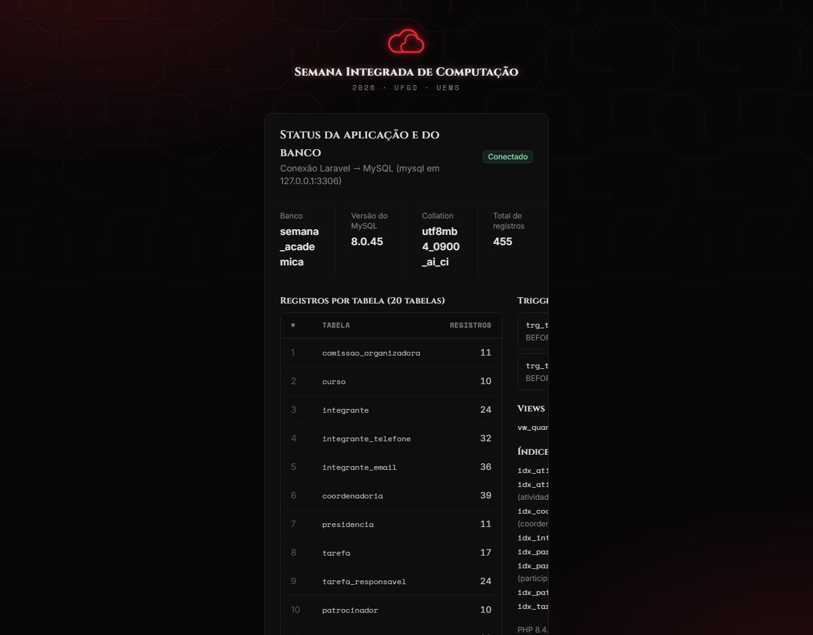

**2. Login do painel**

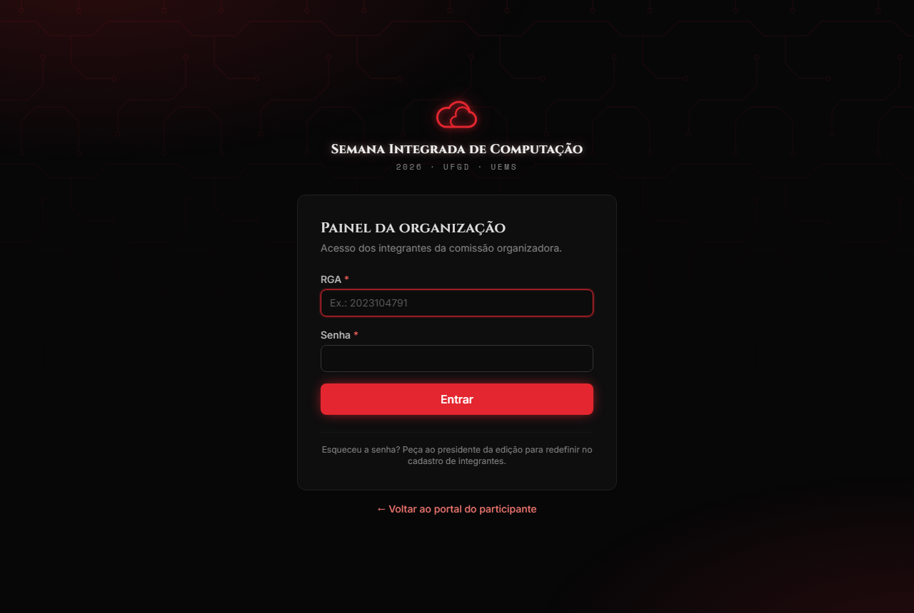

**3. Dashboard da edição**

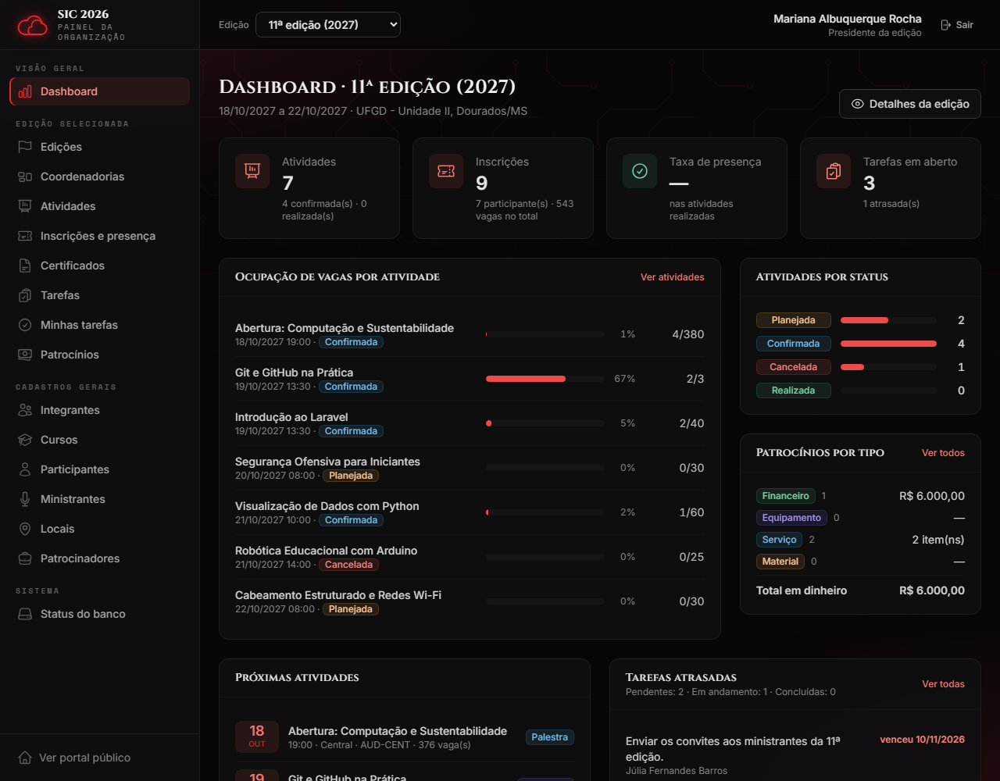

**4. Edição com presidente/vice (formulário)**

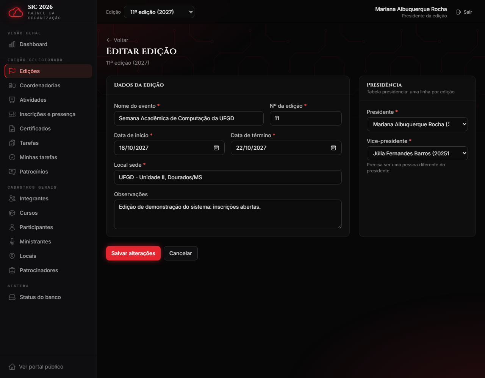

**5. Atividades (listagem com inscritos/vagas)**

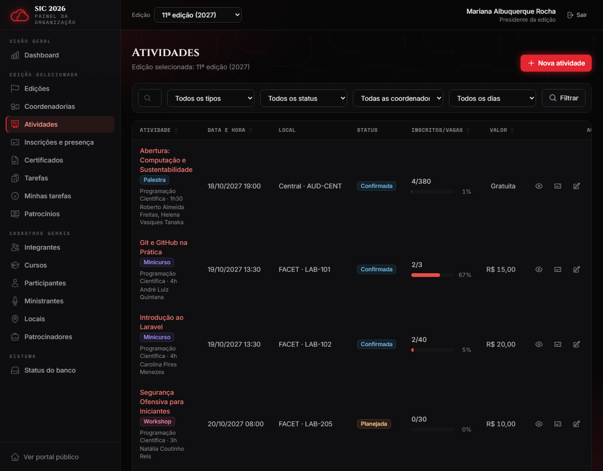

**6. Formulário de atividade com ministrantes (multi-select)**

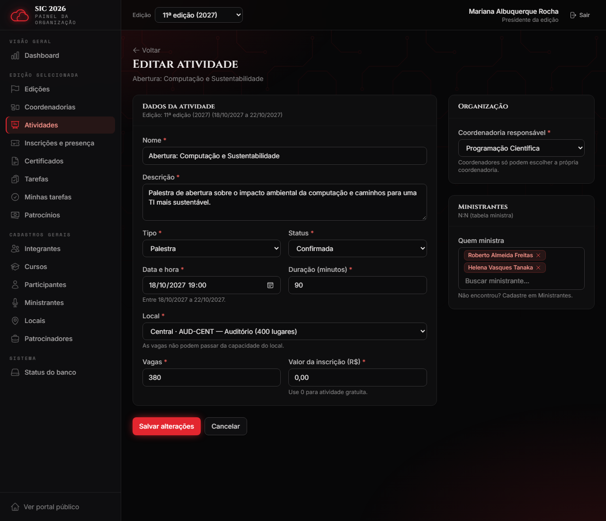

**7. Integrante com telefones e e-mails (listas dinâmicas)**

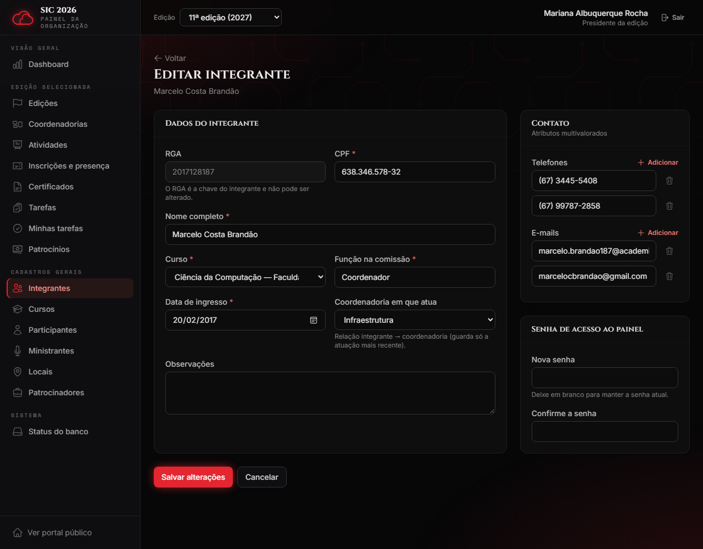

**8. Tarefas com as atrasadas destacadas**

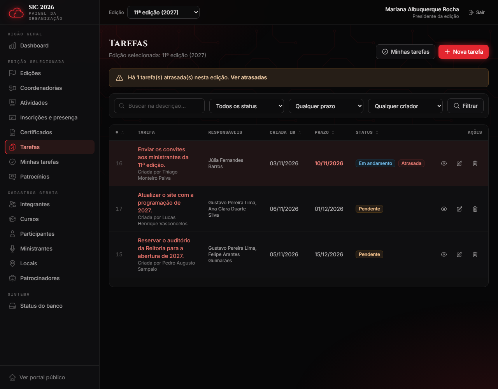

**9. Inscrições e presença (credenciamento em lote)**

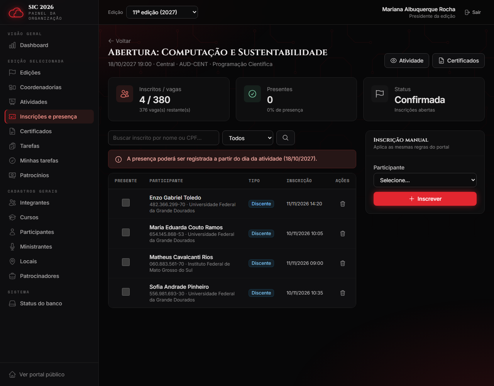

**10. Mensagem "Não é possível excluir: existem X vinculados"**

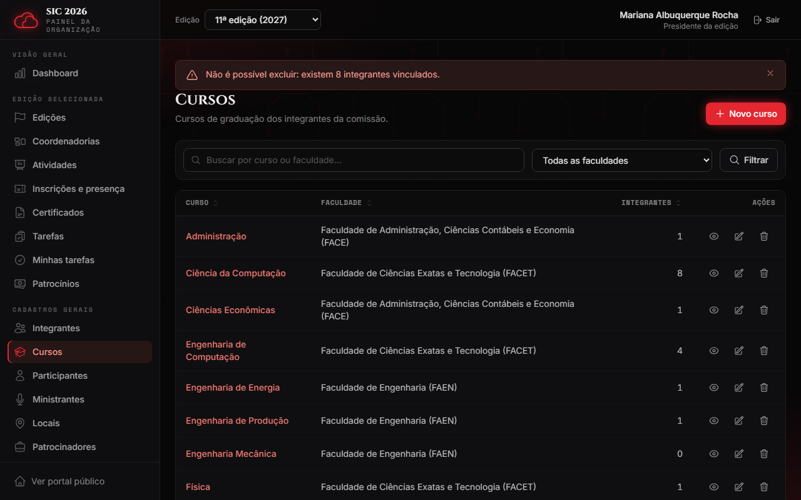

**11. Portal: página inicial**


**12. Portal: programação (celular)**


**13. Portal: atividade com poucas vagas e botão de inscrição**

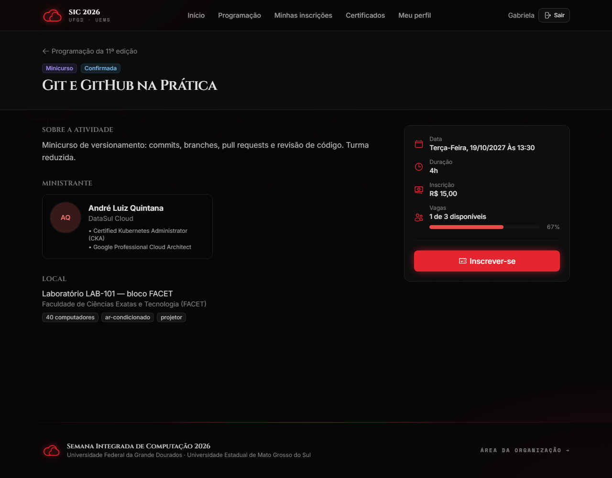

**14. Login recusado de conta bloqueada**

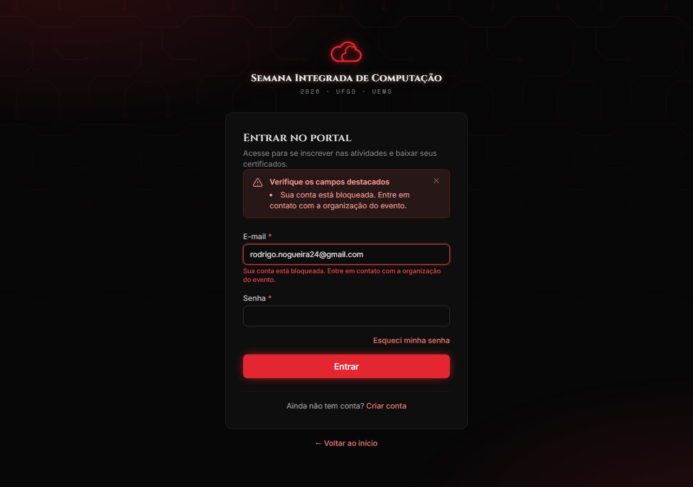

**15. Certificado (A4 paisagem)**

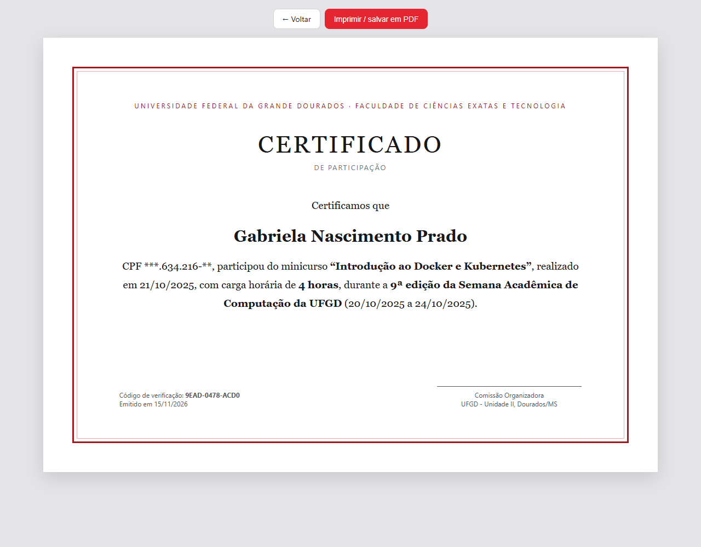

## 12. Entrega final

### 12.1 Checklist da entrega (N2)

- [x] **Link do repositório** (público ou com acesso para o professor) — com as tags `v1-parte1` … `v4-parte4`
- [ ] **URL publicada** funcionando (preenchida no topo deste README)
- [ ] **Script do banco**: `database/sql/script.sql` (+ `script_deploy*.sql`, `senhas_teste.sql`, `dados_demo.sql`)
- [x] **README** com a tabela de credenciais (seção 3) e as capturas de tela (seção 11) preenchidas
- [ ] **Vídeo** de apresentação (roteiro abaixo) — link no topo deste README
- [ ] Conferir no ar: login dos 4 perfis do painel, participante ativo, participante bloqueado, `/status`

### 12.2 Roteiro do vídeo (≈ 10 minutos)

| # | Bloco (critério) | Tempo | O que mostrar |
|---|---|---|---|
| 1 | **Abertura** | 0:30 | Nome do projeto, autores e as duas áreas (painel e portal). URL publicada na barra do navegador. |
| 2 | **Parte 1 — Estrutura e conexão** | 1:30 | Repositório no GitHub: pastas, `composer.json`/`package.json`, `.env.example`, `database/sql/`. Abrir **`/status`** no endereço publicado: banco, versão do MySQL, contagem das 20 tabelas, 2 triggers, view e 8 índices. |
| 3 | **Parte 2 — Cadastro e navegação** | 2:00 | Login do presidente (`2023104791`). Trocar a edição no seletor. Dashboard. Listagem de participantes com busca, filtro e ordenação. Cadastrar um **curso** e mostrar o detalhe gravado. Portal: página inicial e programação no **celular** (modo responsivo do navegador). |
| 4 | **Parte 3 — CRUD com registros relacionados** | 2:30 | Editar um **integrante**: adicionar/remover telefones e e-mails (lista dinâmica) e escolher a coordenadoria em que atua (relação circular). Editar uma **atividade** e trocar ministrantes (`sync`). Criar um **patrocínio** e mostrar o total no rodapé; editar pela rota com as duas chaves. Tentar **excluir o curso "Ciência da Computação"**: mensagem "Não é possível excluir: existem X integrantes vinculados". |
| 5 | **Regras de negócio** | 2:30 | a) **Lotação**: no portal, `gabriela.prado11@gmail.com` se inscreve em "Git e GitHub na Prática" (3ª e última vaga); `joao.leal12@gmail.com` tenta e aparece "Atividade lotada". b) **Status**: "Robótica Educacional" (cancelada) não aceita inscrição. c) **Bloqueio**: login de `rodrigo.nogueira24@gmail.com` é recusado. d) **Trigger de tarefa**: como coordenador (`2026113855`) criar uma tarefa; como integrante comum (`2026116444`) o botão não aparece e a URL dá 403; no MySQL Workbench, rodar o `INSERT` com um não coordenador e mostrar o erro 45000 do trigger. e) **Presença e certificado**: presença em lote numa atividade de 2026 e o certificado da Gabriela em "Meus certificados" (imprimir em A4 paisagem). |
| 6 | **Sistema publicado e encerramento** | 1:00 | Navegar no endereço publicado (portal + painel), mostrar a tabela de credenciais do README e resumir as decisões técnicas (PK composta, MAX+1, SHA-256, trigger). |

SQL para o bloco 5d (deve falhar com *"Somente coordenadores podem criar tarefas."*):

```sql
INSERT INTO tarefa (id_tarefa, descricao, data_criacao, prazo_final, status, rga_criador)
VALUES (999, 'Teste do trigger', '2026-11-14', '2026-11-20', 'pendente', '2026116444');
```

### 12.3 Checklist de testes manuais

Use as credenciais da seção 3 e a edição 11 (2027) do `dados_demo.sql`.

**Regras da seção 4 do enunciado**

- [ ] **Presidente ≠ vice:** em *Edições › Nova edição*, escolher a mesma pessoa nos dois campos → erro "Presidente e vice-presidente devem ser pessoas diferentes".
- [ ] **Uma presidência por edição:** editar a presidência de uma edição e confirmar no detalhe que continua havendo um único presidente e um único vice.
- [ ] **Vagas ≤ capacidade:** criar atividade no LAB-205 (30 lugares) com 31 vagas → erro na capacidade.
- [ ] **Capacidade ≥ vagas existentes:** editar o local AUD-CENT (atividade com 380 vagas) para capacidade 100 → erro.
- [ ] **Inscritos ≤ vagas:** com dois participantes, ocupar a última vaga de "Git e GitHub na Prática" → o segundo recebe "Atividade lotada".
- [ ] **Vagas ≥ inscritos:** editar a atividade 5 (12 inscritos) para 5 vagas → erro.
- [ ] **Data dentro da edição:** criar atividade da 11ª edição em 30/10/2027 → erro com o período 18/10/2027 a 22/10/2027.
- [ ] **Inscrição antes da atividade:** abrir uma atividade de 2026 (já passou) → "Inscrições encerradas", e o POST direto também é recusado.
- [ ] **Sem duplicidade:** depois de inscrito, a página da atividade mostra "Você está inscrito(a)" no lugar do botão, e a *Inscrição manual* do painel não lista quem já está inscrito. Um segundo envio do formulário (ex.: voltar no navegador e reenviar) é recusado com "já está inscrito" (também coberto pelo teste `test_inscricao_lotacao_duplicidade_e_cancelamento`).
- [ ] **Só planejada/confirmada:** "Robótica Educacional" (cancelada) → "Inscrições indisponíveis".
- [ ] **Cancelamento:** em *Minhas inscrições*, cancelar uma inscrição futura → a vaga volta. Uma atividade passada não oferece o cancelamento.
- [ ] **Presença dá certificado:** em *Inscrições e presença* de uma atividade de 2026, marcar presentes e salvar → o participante passa a ver o certificado. Sem presença, `/meus-certificados/{id}` dá 404.
- [ ] **Presença só a partir do dia:** em uma atividade de 2027 os checkboxes ficam desabilitados, com aviso.
- [ ] **Início da coordenação ≥ ingresso:** criar coordenadoria com coordenador que ingressou em 09/03/2026 e início em 01/01/2026 → erro.
- [ ] **Conta inativa/bloqueada:** login de `rodrigo.nogueira24@gmail.com` (bloqueado) e `clara.fagundes21@gmail.com` (inativo) → recusado com mensagem. Bloquear pelo painel um participante logado → a sessão dele cai na próxima página.
- [ ] **Ministrante a partir de participante:** em *Ministrantes › Novo*, a lista só mostra quem ainda não é ministrante.

**Triggers `trg_tarefa_criador_bi` / `trg_tarefa_criador_bu`**

- [ ] **BEFORE INSERT:** no MySQL, `INSERT` em `tarefa` com `rga_criador = '2026116444'` → erro 45000 "Somente coordenadores podem criar tarefas.".
- [ ] **BEFORE UPDATE:** `UPDATE tarefa SET rga_criador = '2026116444' WHERE id_tarefa = 4;` → mesmo erro.
- [ ] **No sistema:** o integrante comum não vê "Nova tarefa" e recebe 403 em `/admin/tarefas/create`. O coordenador cria em nome próprio. A presidência só consegue escolher coordenadores como criador.
- [ ] **UPDATE aceito:** o responsável (Gustavo) muda o status da tarefa 4 em *Minhas tarefas* → sucesso (o trigger BEFORE UPDATE aceita porque o criador é coordenador).

**Integridade e interface**

- [ ] Excluir curso, local, patrocinador ou participante com vínculos → "Não é possível excluir: existem X ... vinculados" (sem erro 500).
- [ ] CPF inválido (`111.111.111-11`) no cadastro → "O CPF informado é inválido". CPF e telefone gravados só com dígitos e exibidos com máscara.
- [ ] Páginas 403, 404 e 419 personalizadas (ex.: `/admin/cursos/999`).

## 13. Organização em partes (tags Git)

| Tag | Parte | Conteúdo |
|---|---|---|
| `v1-parte1` | Estrutura | Laravel + Vite + Tailwind + Alpine, conexão com o banco, guards, models, layouts navegáveis, `/status`, páginas de erro |
| `v2-parte2` / `v3-parte3` | Funcionalidades básicas e avançadas | Autenticação, CRUD completo de todas as entidades, registros relacionados, regras de negócio, permissões, portal completo e testes (as duas partes foram entregues no mesmo commit) |
| `v4-parte4` | Implantação e documentação | Scripts de deploy (MySQL/MariaDB), ajustes de produção (proxy/HTTPS), este README |
